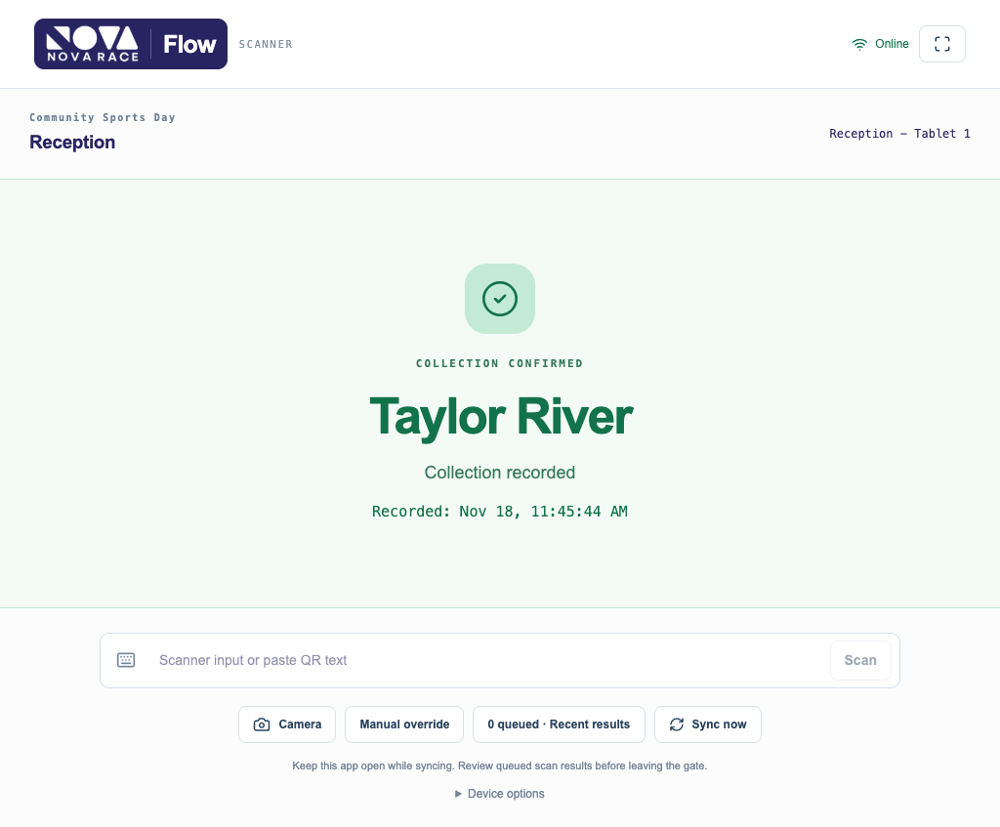

# NovaRace Flow: organiser onboarding guide

For event organisers, gate leads and volunteers. Updated 18 November 2026.

## 1. Start here

A practical guide for event organisers and gate volunteers.

NovaRace Flow connects your guest list, event passes and gate tablets. Organisers prepare the event in the admin dashboard. Volunteers use the scanner app to check passes at a specific gate or counter.

### What you need before setup

- The live NovaRace Flow web address and organiser login, supplied by your setup team.
- A participant list with Email and Full Name, in Excel (.xlsx) or CSV format.
- Your checkpoint plan: for example Reception, Kit Collection, Meal and T-shirt.
- An Android tablet with Chrome for each scanning station, chargers and working internet for setup.
- A QR-capable hardware scanner, or permission to use the tablet camera.
- If emailing passes: SMTP settings and an approved sender address from your email provider.

> **Use the live address**
>
> Every tablet must be able to open the same deployed NovaRace Flow site over HTTPS. A localhost address works only on the computer running it; it is not a link for volunteers on other devices. Ask your setup team for the live organiser link and the same site with /scanner added.

### Who does what

| Role                   | Responsibilities                                                                                          |
| ---------------------- | --------------------------------------------------------------------------------------------------------- |
| Organiser / admin      | Create events and gates, import guests, send passes, pair tablets, monitor progress and undo mistakes.    |
| Volunteer              | Use the paired scanner, read the result, complete the gate action and refer exceptions to the event lead. |
| Setup / technical team | Provide the working HTTPS site, email configuration and help with device or connectivity issues.          |

### Follow this setup order

Create event (page 2) > Add participants (page 2) > Create gates (page 3) > Send passes (page 4) > Pair tablets (page 5) > Connect scanners (page 6) > Rehearse and open gates (page 7).

This guide matches the current NovaRace Flow interface. Screenshots use demonstration data. Keep admin credentials and one-time pairing codes within your event team.

## 2. Create the event and guest list

Organiser dashboard | Complete this before sending passes.

### 1. Create your event

1. Sign in using the organiser link. Choose Create event in the sidebar.
2. Enter Event name, then IANA timezone. For an event in India, use Asia/Kolkata.
3. Optionally fill Start (UTC). This field expects UTC, not local event time. For example, 12 December at 09:00 IST is 12 December at 03:30 UTC. Leave it blank if the start time is not needed.
4. Select Save event. Confirm the correct event is selected in the sidebar before continuing. Use Edit event to change its details later.

### 2. Prepare the participant file

| Column                      | What to enter                                                                       |
| --------------------------- | ----------------------------------------------------------------------------------- |
| Email - required            | One valid email address per participant; unique within this event.                  |
| Full Name - required        | The name volunteers should see when the pass is scanned.                            |
| Phone, Ticket Type, Company | Optional details. Format phone cells as text to preserve + signs and leading zeros. |
| Any other columns           | Optional details such as dietary preference or T-shirt size; stored as metadata.    |

Use the provided participant template. Keep headers in the first row and guests on the first worksheet. The upload limit is 5 MB and 10,000 participant rows per file.

### 3. Import or add guests

1. Open Participants > Import participants and choose your .xlsx or .csv file.
2. Read the imported and rejected counts. Invalid rows and duplicate emails appear with an issue and row number.
3. Correct rejected rows and upload only those corrected rows. Existing guests are not overwritten; re-uploaded emails are reported as duplicates.
4. For one guest, choose Add participant, enter Full name and Email, and select Save participant. Keep Active pass selected for valid guests.
5. Search by name or email to check your list. Use Edit to correct a profile, and QR to view or download a generated pass.

> **Ready check**
>
> Find a known participant, check the spelling and email, and open QR. A pass is generated automatically; you do not need a separate QR generator.

## 3. Create gates and counters

Organiser dashboard | Gates are the checkpoints you want to track.

A gate can represent entry, reception or any collection counter. Give each distinct checkpoint its own gate. Pair multiple tablets to the same gate when volunteers share the same allowance.

### 1. Add a gate

1. Open Gates > Add gate.
2. Enter a clear Gate name, such as Reception or Kit Collection.
3. Set Maximum collections per participant. Use 1 for a single entry or one item per guest.
4. Under Required previous gates, select any checkpoints that must already be completed. Leave all unchecked for an independent gate.
5. Choose Save gate. Repeat for the remaining checkpoints. Use Edit gate if a rule needs changing.

### Example event plan

| Gate / counter | Maximum | Required previous gate                                    |
| -------------- | ------- | --------------------------------------------------------- |
| Reception      | 1       | None                                                      |
| Kit Collection | 1       | Reception                                                 |
| Meal           | 1       | Reception                                                 |
| T-shirt        | 1       | Reception                                                 |
| Goodies        | 1       | Reception and Kit Collection, if your event requires both |

These are example rules, not automatic defaults. Choose dependencies that match your event. If more than one gate is selected, the guest must complete every selected gate first.

> **Two tablets, one kit allowance**
>
> For two kit volunteers, create one Kit Collection gate and pair both tablets to it. Do not create Kit A and Kit B unless guests are meant to have separate allowances: separate gates have separate limits. Global limits are enforced when scans reach the server.

### 2. Test the sequence

With a test participant, scan at Kit Collection before Reception: it should be rejected with a message to visit Reception. Scan Reception, then Kit Collection: both should succeed in that order. Scan Kit Collection again: it should report Already collected.

If you use a real guest for rehearsal, an admin must undo the test collections before doors open. Agree gate rules before the event; changing them during service affects later validations.

## 4. Send QR passes to participants

Organiser dashboard | Configure delivery, test one pass, then send the guest list.

### 1. Configure email delivery

1. Open Settings > SMTP delivery. Obtain the SMTP host, port, username, password or token, and verified sender email from your setup team.
2. Enter the settings and choose Save SMTP settings. These settings are shared across this NovaRace Flow installation.
3. For ZeptoMail, use the host shown in your own account. For the usual port 587 setup, leave Implicit TLS unchecked. If your provider specifies port 465, select Implicit TLS. Follow the provider account settings rather than guessing the region or host.

### 2. Personalise the pass

1. Open Emails > Event pass template.
2. Edit Subject and Message. Keep the message short and tell guests to have the QR ready at the event.
3. Choose Save template. The QR image is included automatically; do not paste a QR image into the message.

| Variable                     | Replaced with                         |
| ---------------------------- | ------------------------------------- |
| {{name}} / {{email}}         | The participant name / email address  |
| {{event}}                    | The selected event name               |
| {{ticketType}} / {{company}} | The participant ticket type / company |

### 3. Test, then send

1. Add an active test participant using an email inbox your team can access. In Participants, choose Email pass on that row.
2. Confirm the message arrives, check the QR image and scan it on a paired tablet. If it does not arrive, check spam and the Email delivery status before sending more.
3. When the test passes, open Emails > Send all passes and confirm. This queues passes for active participants.
4. Monitor Email delivery. Queued or sending is not proof of delivery. Sent means the mail server accepted the email; check a sample inbox as well.
5. For a failed job, correct the underlying issue and choose Retry. To send a delivered pass again, use Email pass in Participants.

> **If email is unavailable**
>
> Use Participants > QR > Download QR to obtain a guest pass and distribute it using your event's approved method. Share the individual pass privately. Do not share screenshots of the full guest list.

## 5. Give volunteers the scanner app

Organiser + volunteer | Pair each tablet to the right event and gate.

The volunteer app is the NovaRace Flow scanner at the same live site with /scanner added. It opens in Chrome and can be installed on the tablet home screen. There is no separate app-store download and volunteers do not need the organiser password.

### 1. Organiser: prepare the tablet assignment

1. Select the event, open Gates, and choose Pair a tablet on the intended gate.
2. Give the volunteer the scanner link and the new 8-digit pairing code. A code expires after 10 minutes and can be used only once.
3. Generate a separate code for every tablet, even when several tablets share one gate.

### 2. Volunteer: pair the tablet

1. Connect the tablet to the internet and open the organiser-provided scanner link in Chrome. Use a normal browser window, not Incognito.
2. Enter Tablet name using a recognisable label, such as Reception - Tablet 1.
3. Enter the 8-digit pairing code and choose Pair this tablet.
4. Check the event name, gate name and tablet name displayed on the scanner screen. Confirm Ready to scan appears. Stop and ask the organiser if the assignment is wrong.

### 3. Make it easy to use at the gate

1. If Chrome offers Install app or Add to Home screen, use it to add NovaRace Flow to the tablet. Menu wording can vary. You can also use the scanner directly in Chrome.
2. Open the installed app or scanner link and tap the fullscreen control at the top right if needed. Keep the screen awake using the tablet settings or your managed-device settings.
3. While online, complete a test scan. Before relying on offline mode, ask the setup team to confirm it is enabled on the deployed site, then temporarily disconnect and confirm the scanner can reopen. Reconnect before the gate opens.

> **Before handing over**
>
> Label the tablet and its physical counter. The organiser can check Devices for the tablet name, assigned gate and last-seen time. Pairing confirms the assignment; it does not replace a real hardware or camera test.

If a tablet must move to another gate, first reconnect and confirm 0 queued. Then use Device options > Remove pairing and pair it again with a fresh code for the new gate. Never change pairing while scans are pending.

## 6. Connect a scanner or use the camera

Volunteer + setup team | Test with a real NovaRace Flow QR pass.

> **Choose QR-capable hardware**
>
> NovaRace Flow passes are QR codes. A scanner that reads only 1D barcodes cannot read them. Use a 2D QR-capable scanner in USB HID or Bluetooth HID keyboard mode. A successful hardware beep only means it read the code; the NovaRace Flow screen gives the collection result.

### Option A - USB scanner

1. Connect the scanner to the tablet using its supported USB connection. A tablet may need a compatible USB-C OTG adapter or powered hub.
2. Use the scanner manufacturer's setup guide or configuration barcodes to select USB HID / Keyboard mode and an Enter (carriage-return) suffix.
3. Open NovaRace Flow and keep Ready to scan visible. Close dialogs and aim the scanner at a guest QR code.
4. If the scanner beeps but nothing happens, tap the Scanner input or paste QR text field and scan again. If text appears without submitting, check the Enter suffix or tap Scan.
5. Check the on-screen guest name and result before completing the gate action.

### Option B - Bluetooth scanner

1. Put the scanner in Bluetooth HID / Keyboard mode and follow its manufacturer's instructions to pair it through the tablet Bluetooth settings. Some scanners use a USB receiver instead; follow that model's instructions.
2. Set the Enter suffix. Keep the scanner charged and make sure it is connected to the intended tablet, not a nearby device.
3. Return to NovaRace Flow and test a QR pass. If text lands in the scanner input but does not submit, use Scan and ask the setup team to fix the suffix.

### Option C - Tablet camera

1. On the scanner screen, choose Camera. Allow camera access if Chrome asks.
2. Hold the full QR inside the camera view. Increase the guest phone brightness, avoid glare and keep the code steady. NovaRace Flow requests the rear camera where available.
3. When the code is read, the camera view closes and the scan result appears. Use the result on screen, not just the camera action, to decide what to do.
4. If access is blocked, ask the setup team to check camera permission for the site and confirm the live link uses HTTPS. Close other apps using the camera, then retry.

Scanner settings and adapters depend on the hardware model. Ask the setup team to configure each model before volunteers arrive; the NovaRace Flow app cannot change the scanner's HID mode or suffix.

## 7. Read scan results

Volunteer | Read the message, check the guest name, then act.

Example: a server-confirmed collection, shown with demonstration guest data.

| Screen result                | Volunteer action                                                                                                                                             |
| ---------------------------- | ------------------------------------------------------------------------------------------------------------------------------------------------------------ |
| Green - collection confirmed | Complete the gate action for the displayed guest.                                                                                                            |
| Amber - already collected    | Check the previous collection timestamp. Do not issue the item or entry again; refer a dispute to the event lead.                                            |
| Red - scan not accepted      | Read the reason. Direct the guest to the required gate, correct event pass, or organiser help desk.                                                          |
| Amber - pending validation   | Saved on this tablet, but not yet approved. Wait for confirmation before issuing controlled items or follow the event lead's explicit provisional procedure. |

### If the network drops

Keep the same tablet and app. Offline scans are queued, but changed rules, deactivated passes and other tablets' collections cannot be checked until sync. Offline mode cannot guarantee duplicate prevention across tablets.

Reconnect, keep NovaRace Flow open, and choose Sync now if needed. Wait for 0 queued, then open Recent results and review any rejected or already-collected scans. The Online label alone does not prove that syncing has completed.

Do not clear site data, uninstall the app, remove pairing or switch to Incognito while scans are queued. If the app says a scan was NOT saved, stop: that scan is not safely queued. Ask for help rather than handing out an item on that basis.

## 8. Resolve issues and close

Organiser + event lead | Resolve issues without losing scan history.

### Broken phone or an approved exception

Follow your event's identity-check and approval process. While online, choose Manual override > Find participant. Enter at least two characters of a name or email, select the guest and enter a specific Reason for override. Choose Record manual collection and check the result.

> **Use overrides carefully**
>
> Overrides bypass gate order and collection limits and are audited. They cannot activate a deactivated guest. Paired volunteers have this action; agree who may approve it before doors open.

### Common problems

| Problem                            | What to do                                                                             |
| ---------------------------------- | -------------------------------------------------------------------------------------- |
| Pairing code rejected              | Request a fresh code for the right gate. Codes expire after 10 minutes and work once.  |
| Scanner beeps; no result           | Check QR support, HID mode and Enter suffix. Focus the scanner input and retry.        |
| Camera will not open               | Check site camera permission, HTTPS and other camera apps. Try hardware scanning.      |
| Wrong sequence or event            | Direct the guest to the named previous gate or request this event's pass.              |
| Pass deactivated or unknown        | Refer to the organiser. Keep your identity checks in place.                            |
| Sync paused / authorisation failed | Preserve queued data. Ask the technical team to investigate; do not revoke or re-pair. |

### Correct a mistaken collection - admin only

In Participants, find the guest and choose Collections. Review the counter, choose Undo latest or Reset all at this counter, enter a reason and confirm any impact warning. Ask the volunteer to tap Sync now online, then scan the same QR again. Audit history is retained; downstream counters are not automatically reset.

### Before doors open and before you close

Before opening: check tablet assignments, charging, connectivity and scanners. Rehearse results and undo test collections. During service, Overview refreshes about every five seconds; Devices shows assignments and last-seen times.

At close: reconnect all tablets, confirm 0 queued and review Recent results. In Settings, use Export scan log and Export participant status for your records. Resolve queues before revoking or unpairing devices. Exports use UTC; screens use the event timezone.

For the full correction workflow, including offline tablets and counter resets, see [Correcting collections](collection-resets.md).
